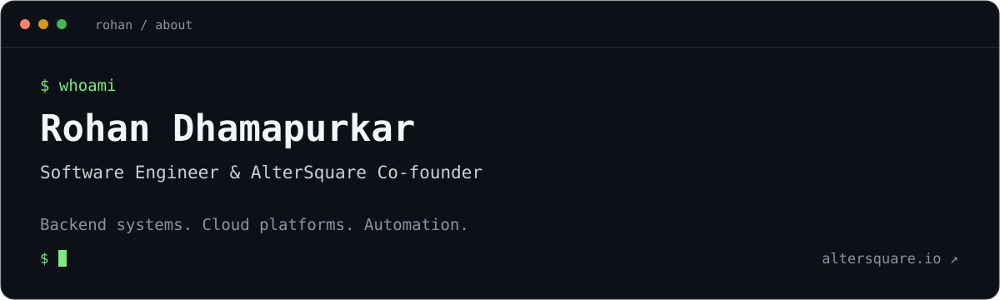

I build backend systems, platforms, and automation that make complex work easier.

I'm Rohan, a software engineer, technical consultant, and co-founder of [AlterSquare](https://altersquare.io). My work spans backend systems, application architecture, cloud infrastructure, and automation. I got into programming in my second year of engineering, and have kept building ever since.

I care about solving the actual business problem, designing for long-term evolution, and helping products scale.

### `~/work`

- **Platform engineering** — infrastructure, delivery pipelines, and reliable services.
- **Backend systems** — APIs, microservices, and event-driven architectures.
- **Data & automation** — database design and workflows that reduce manual work.

### `~/toolbox`

| Area | Tools & technologies |
| :--- | :--- |
| Languages & backend | Go, JavaScript / TypeScript, Node.js, NestJS |
| Data | PostgreSQL, MongoDB, Redis, TimescaleDB |
| Infrastructure | Docker, Kubernetes, Terraform, CI/CD |

I use AI coding tools as part of my development workflow, with hands-on review and testing guiding what ships.

### `~/altersquare`

At AlterSquare, we help teams build, improve, and extend their software systems.

**[Explore AlterSquare →](https://altersquare.io)**

---

[LinkedIn](https://www.linkedin.com/in/rohandhamapurkar/) · [Email](mailto:rohan@altersquare.io)
